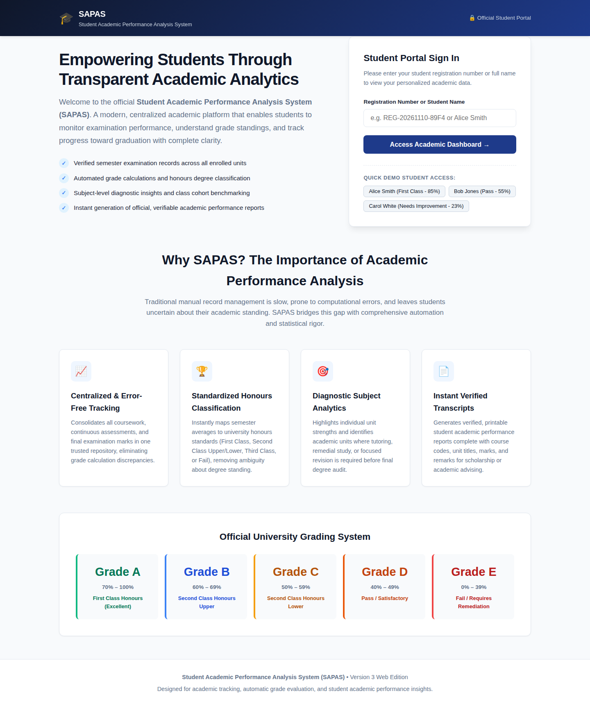
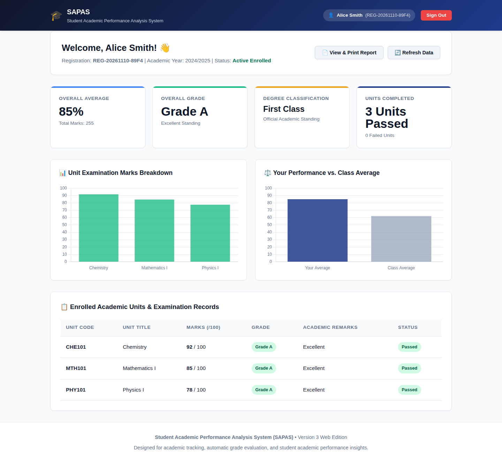

# Student Academic Performance Analysis System (SAPAS)

### BCS 360 – Introduction to Python | Academic Year 2026/2027 | Third Year, First Semester

A Python-based academic management and performance analysis system designed to manage student records, process academic marks, calculate grades, and generate meaningful academic performance reports.

---
| No. | Group Member | Registration Number |
|---|---|---|
| 1 | ANTONY SIFUNA | COM/B/01-02365/2024 |
| 2 | DENVER WALUSALA | COM/B/01-03766/2024 |
| 3 | SULEIMAN IBRAHIM MUHAMED | COM/B/01-05865/2024 |

## Project Overview

The **Student Academic Performance Analysis System (SAPAS)** is a database-driven Python application developed as a group assignment for the BCS 360 Introduction to Python course.

### Web Interface





The system aims to simplify academic performance tracking by providing tools for student registration, academic unit management, marks recording, automatic grading, student ranking, and class performance analysis.

It transforms raw academic marks into structured information that can help students, lecturers, and academic administrators understand individual and overall academic performance.

The initial implementation focuses on a Python command-line interface, with an architecture designed to support future integration with a web-based interface using HTML, CSS, JavaScript, and a Python backend API.

## Project Objectives

1. Develop a functional academic performance management system using Python.
2. Demonstrate practical application of fundamental Python programming concepts.
3. Implement relational database management using SQLite.
4. Automate student grading and academic performance calculations.
5. Generate individual and class-wide academic performance reports.
6. Identify top-performing students and students requiring academic improvement.
7. Establish a modular and scalable foundation for future web integration.

## Key Features

| Module | Functionality |
|---|---|
| Student Management | Register, search, update and delete student records |
| Unit Management | Create and manage academic units |
| Enrollment Management | Assign academic units to students |
| Marks Management | Record and update student assessment marks |
| Automatic Grading | Calculate grades based on configured grading criteria |
| Individual Analysis | Generate individual academic performance summaries |
| Class Analysis | Calculate class averages and pass rates |
| Student Ranking | Rank students based on academic performance |
| Report Generation | Generate academic performance reports |
| Database Management | Store and retrieve academic records using SQLite |

## Grading System

The application uses the following grading scale:

| Marks Range | Grade | Classification |
|---|---|---|
| 70–100 | A | Excellent |
| 60–69 | B | Very Good |
| 50–59 | C | Good |
| 40–49 | D | Pass |
| 0–39 | E | Fail |

*The grading scale is configurable to accommodate institutional academic policies.*

## Technology Stack

**Programming Language**
- Python 3

**Database**
- SQLite
- Python `sqlite3` module

**Python Libraries and Modules**
- `sqlite3` – Database operations
- `statistics` – Statistical calculations
- `datetime` – Date and time management
- `pathlib` – File and directory management
- `unittest` – Software testing

**Future Development**
- HTML – Web page structure
- CSS – User interface styling
- JavaScript – Interactive dashboards
- FastAPI – Backend API development
- Chart.js – Academic performance visualization

## System Architecture

The project follows a modular architecture that separates database operations, business logic, academic calculations, and user interaction.

```text
              STUDENT / ADMINISTRATOR
                       |
                       v
               COMMAND-LINE INTERFACE
                       |
                       v
              APPLICATION MODULES
                       |
          +------------+------------+
          |            |            |
          v            v            v
       STUDENT       MARKS       PERFORMANCE
      MANAGEMENT  MANAGEMENT      ANALYSIS
          |            |            |
          +------------+------------+
                       |
                       v
                 DATABASE LAYER
                       |
                       v
                SQLITE DATABASE
```

## Database Design

The system uses SQLite as its relational database management system.

Proposed database tables:

- `students` – Stores student registration details.
- `units` – Stores academic unit information.
- `enrollments` – Maintains student-to-unit relationships.
- `assessments` – Stores assessment definitions.
- `marks` – Stores student assessment scores.
- `academic_records` – Stores semester and academic year information.

Database constraints and relationships help maintain data integrity and consistency.

## Project Structure

```text
student-academic-performance-analysis/
│
├── main.py
│
├── database/
│   ├── db_connection.py
│   ├── schema.sql
│   └── student_performance.db
│
├── modules/
│   ├── student_manager.py
│   ├── unit_manager.py
│   ├── enrollment_manager.py
│   ├── marks_manager.py
│   ├── grading.py
│   ├── performance_analysis.py
│   ├── ranking.py
│   └── report_generator.py
│
├── reports/
├── tests/
├── screenshots/
│
├── README.md
├── requirements.txt
└── .gitignore
```

*The structure represents the planned modular organization and should be adjusted to match the actual implementation.*

## Python Concepts Demonstrated

This project demonstrates the following concepts covered in Introduction to Python:

- Variables and data types
- User input and output
- Arithmetic and comparison operators
- Conditional statements (`if`, `elif`, `else`)
- Iteration (`for` and `while` loops)
- Functions and modular programming
- Lists, tuples and dictionaries
- String manipulation
- Exception handling
- File and database operations
- Basic statistical analysis
- Unit testing

## Installation and Setup

### Prerequisites

- Python 3.10 or later
- Git
- A terminal or command-line environment

### 1. Clone the repository

```bash
git clone https://github.com/YOUR_USERNAME/student-academic-performance-analysis-asignment-python-2026-27-thirdyrfirst-sem.git
```

### 2. Navigate to the project directory

```bash
cd student-academic-performance-analysis-asignment-python-2026-27-thirdyrfirst-sem
```

### 3. Run the application

```bash
python3 main.py
```

The application should initialize the SQLite database automatically if it does not already exist.

## Testing

Run the project's unit tests using:

```bash
python3 -m unittest discover -s tests -v
```

Tests should cover grading calculations, student registration, database operations, marks validation, average calculations, rankings, and performance analysis.

## Future Improvements

The project is designed for progressive development.

Planned improvements include:

- Development of a modern web-based dashboard.
- HTML, CSS and JavaScript frontend integration.
- FastAPI backend integration.
- Interactive charts for academic performance visualization.
- Student and administrator authentication.
- Exporting reports to PDF and Excel.
- Academic progress tracking across multiple semesters.
- Performance trends and historical comparisons.

## Group Members

**Course:** BCS 360 – Introduction to Python

**Academic Year:** 2026/2027

**Academic Period:** Third Year, First Semester

| No. | Group Member | Registration Number |
|---|---|---|
| 1 | ANTONY SIFUNA | COM/B/01-02365/2024 |
| 2 | DENVER WALUSALA | COM/B/01-03766/2024 |
| 3 | SULEIMAN IBRAHIM MUHAMED | COM/B/01-05865/2024 |

## Academic Context

This project is submitted as a group assignment for the BCS 360 Introduction to Python course.

It provides a practical demonstration of how Python programming and relational databases can be applied to solve real-world academic management and performance analysis challenges.

---

**Project:** Student Academic Performance Analysis System (SAPAS)

**Course Code:** BCS 360

**Academic Year:** 2026/2027

**Semester:** Third Year, First Semester

**Development Language:** Python

**Database:** SQLite

---

*Developed collaboratively as part of an academic programming assignment.*
